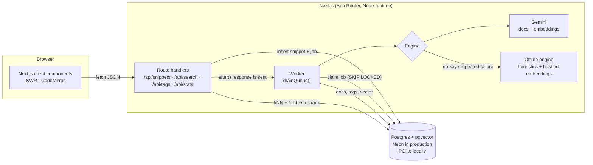

# AI Code Snippet & Documentation Hub

A full-stack knowledge base for code snippets. Paste code in any language. A background worker uses an LLM to write documentation, extract semantic tags and create vector embeddings, so you can find the snippet later by describing what it does ("how to connect to redis in nodejs") rather than remembering what you named it.

**Live app:** https://ai-code-snippet-hub.vercel.app (the full version on Vercel, Neon Postgres and Gemini)
**Browser demo:** https://ethanyap123.github.io/ai-code-snippet-hub/ (runs entirely in your browser; see [Live demo](#live-demo-github-pages))

    [](https://github.com/EthanYap123/ai-code-snippet-hub/actions/workflows/pages.yml)

## Features

- **Code editor** — CodeMirror 6 with lazily loaded grammars for 20+ languages, auto language detection, a size limit and Ctrl+Enter to save.
- **Background enrichment** — every submission becomes a job. A worker generates a structured write-up (summary, explanation, parameters, return value, usage example, complexity, notes), semantic tags and a 768-dimension embedding.
- **Semantic search** — natural-language queries are embedded and matched through a pgvector HNSW index, then re-ranked with Postgres full-text search. Typical response time is tens of milliseconds.
- **Related snippets** — nearest neighbours in vector space, shown on every snippet page.
- **Works without an API key** — a built-in offline engine (static analysis plus feature-hashed embeddings with developer synonyms) takes over when no key is set, or when the LLM keeps failing, so the app never ends up broken.
- **Developer-friendly UI** — dark mode (light / dark / system), Shiki syntax highlighting in both themes, loading skeletons, clear error and empty states, keyboard shortcuts (`/` or Ctrl+K to search) and a responsive layout down to 375 px.

## Architecture



### Request flow

1. **Submit.** `POST /api/snippets` validates the body with Zod, detects the language if it's set to auto, rate-limits per visitor, and stores the snippet plus a row in `jobs`. It responds with `201` straight away.
2. **Background work.** Next.js `after()` runs the worker once the response is sent. The worker claims jobs atomically:

   ```sql
   UPDATE jobs SET status = 'running', attempts = attempts + 1 ...
   WHERE id = (SELECT id FROM jobs WHERE status = 'queued' AND run_after <= now()
               ORDER BY run_after, id LIMIT 1 FOR UPDATE SKIP LOCKED)
   RETURNING ...
   ```

   This is safe with any number of serverless instances. Jobs whose worker died are reclaimed after 2 minutes. Retryable failures (429, 5xx, timeouts) back off exponentially, at 5 s and then 20 s. After three attempts the offline engine fills in.
3. **Enrichment.** The LLM is called in structured-output mode with a JSON response schema, and its output is validated again with Zod. The snippet is wrapped in delimiters, and the system prompt treats it as untrusted data, which guards against prompt injection hidden in code comments.
4. **Live status.** The snippet page polls `GET /api/snippets/:id` every 1.5 s while the job is queued or processing, and shows the pipeline steps. If a job looks stalled, the poll also nudges the worker. A daily Vercel Cron call to `/api/worker` sweeps up anything left over.

### Semantic search

```
query ──► embed (same model as the stored vectors, cached in-process, LRU)
      ──► 50 nearest neighbours via HNSW (cosine distance, `<=>`)
      ──► re-rank: 0.8 × cosine similarity + 0.2 × ts_rank_cd(title A, tags A, summary B)
      ──► drop weak matches (semantic < 0.15, or < 60% of the best score)
```

Embeddings from different models live in different vector spaces. Each stored vector therefore records its model, and the query is embedded once for each model present, so switching providers never mixes incompatible vectors.

### Data model

| Table | Purpose |
| --- | --- |
| `users` | Authors. The demo seeds a curator (`ethanyap`) and a shared `guest` account. |
| `snippets` | Title, language, code, status (`queued → processing → ready / failed`), owner, anonymous visitor id and a salted IP hash for rate limiting. |
| `tags`, `snippet_tags` | Normalised kebab-case tags. `position` keeps the engine's relevance order. |
| `documentation` | One row per snippet: summary, explanation, `params` (jsonb), returns, usage, complexity, `notes` (jsonb) and the model that wrote it. |
| `snippet_embeddings` | `vector(768)` plus its model name, with an HNSW `vector_cosine_ops` index. |
| `jobs` | The work queue: status, attempts, last error, `run_after` for backoff, and `locked_at` for stale-lock recovery. |

The schema is idempotent (`CREATE ... IF NOT EXISTS`) and is applied on the first connection. See [`src/lib/schema.ts`](src/lib/schema.ts).

### Why these choices

- **Next.js route handlers as the backend.** One deployable unit, one language, and typed request/response shapes shared with the client ([`src/lib/types.ts`](src/lib/types.ts)).
- **Postgres + pgvector over a separate vector DB.** Snippets, tags, docs and vectors stay in one transactional store, and hybrid search is a single SQL query.
- **PGlite for local dev.** Real Postgres (compiled to WASM) with pgvector, so `npm run dev` works without Docker or an installed database, and runs the same SQL as production.
- **A database-backed queue instead of Redis/BullMQ.** No extra infrastructure, and `FOR UPDATE SKIP LOCKED` gives correct concurrent claiming. `after()` gives near-instant processing on serverless without a long-running worker process.
- **Client-rendered pages on top of a JSON API.** With Next 16 Cache Components the page shells are prerendered and served instantly, and data streams in with explicit skeleton, error and empty states for every async call.

### Free-tier protection

The public deployment runs on a free Gemini key, so strangers must not be able to burn through its quota. The counters live in Postgres (`ai_usage`, `rate_limits`), so every serverless instance shares them.

- **Per-visitor limits** (keyed by a salted IP hash): 15 new snippets an hour, 5 regenerations an hour and 60 searches a minute. Over the limit the API answers `429` with a friendly message.
- **A daily budget** of Gemini calls for the whole site. Each snippet costs two calls (write-up and embedding) and each uncached search costs one.
- **A circuit breaker.** When Gemini answers `429`, every instance stops calling it: for Gemini's `retryDelay` on a per-minute limit (jobs wait it out), or for an hour when the daily quota is spent.
- **Graceful fallback.** When the budget is spent, Gemini is cooling down or it keeps failing, new snippets are documented by the offline engine straight away, and search falls back to Postgres full-text search for Gemini-embedded snippets. Nothing gets stuck or breaks.

### Live demo (GitHub Pages)

GitHub Pages only serves static files, so the demo is a second build of the same app. `npm run build:demo` sets `NEXT_PUBLIC_DEMO=1`, which:

- switches Next.js to `output: "export"` under the `/ai-code-snippet-hub` base path, and drops the route handlers from the build;
- sends the client's `/api/*` requests to [`src/lib/demo/browser-api.ts`](src/lib/demo/browser-api.ts) instead of the network. That module runs the **same** schema, seed data, worker, validation and SQL as the server, on PGlite with pgvector in the browser, persisted to IndexedDB.

The demo uses the offline engine, because an LLM key can't be shipped in a public page. Snippets visitors add are stored in their own browser only. A GitHub Actions workflow ([`.github/workflows/pages.yml`](.github/workflows/pages.yml)) type-checks, lints, builds and deploys the demo on every push to `main`.

## Tech stack

- **Framework:** Next.js 16 (App Router, Cache Components, Turbopack), React 19, TypeScript
- **Data:** PostgreSQL + pgvector (Neon serverless driver in production, PGlite locally)
- **AI:** Google Gemini (`gemini-3.5-flash-lite` for docs, `gemini-embedding-001` at 768 dimensions), with an offline fallback engine
- **UI:** Tailwind CSS 4, CodeMirror 6, Shiki, SWR, lucide icons
- **Validation:** Zod on every API input and on LLM output

## Project structure

```
src/
  app/
    page.tsx, dashboard.tsx     Search + library dashboard
    new/                        Editor page and form
    snippet/                    Snippet detail at /snippet?id= (docs, related, owner actions)
    about/                      How it works
    api/
      snippets/                 GET list · POST create
      snippets/[id]/            GET detail · DELETE
      snippets/[id]/reprocess/  POST regenerate
      search/  tags/  stats/  health/  worker/
  components/                   UI building blocks (editor, code block, cards, skeletons, toasts, theme)
  lib/
    db.ts                       Neon / PGlite adapter, schema + seed on first use
    schema.ts                   Tables and indexes
    worker.ts                   Job queue: claim, enrich, retry, fallback
    snippets.ts                 Queries: list, detail, related, hybrid search, stats
    ai/gemini.ts                Structured docs + batch embeddings over REST
    ai/local.ts                 Offline engine
    highlight.ts                Shiki (JS regex engine, dual themes)
    languages.ts                Supported languages + detection
    validation.ts               Zod input parsing shared by the API and the demo
    demo/browser-api.ts         In-browser API for the static demo (PGlite + IndexedDB)
scripts/setup.ts                Apply schema, seed, drain the queue, optional test search
scripts/build-demo.mjs          Static GitHub Pages build
```

## Running locally

Requirements: Node.js 20 or newer. No database or API key is needed.

```bash
git clone https://github.com/EthanYap123/ai-code-snippet-hub.git
cd ai-code-snippet-hub
npm install
npm run dev
```

Open http://localhost:3000. On first run the app creates an embedded Postgres database in `.data/pglite`, seeds 14 example snippets and documents them with the offline engine.

To use Gemini, copy `.env.example` to `.env.local` and set `GEMINI_API_KEY` (a free key is available from [Google AI Studio](https://aistudio.google.com/apikey)). Existing snippets keep their offline docs until you regenerate them, so run `rm -rf .data` first if you want everything re-documented by Gemini.

Useful scripts:

| Command | What it does |
| --- | --- |
| `npm run dev` | Dev server |
| `npm run build && npm start` | Production build |
| `npm run build:demo` | Static in-browser demo build into `out/` |
| `npm run db:setup -- "your query"` | Apply schema, seed, process every queued job, then run a test search |
| `npm run typecheck` / `npm run lint` | Type check / lint |

### Environment variables

| Variable | Default | Description |
| --- | --- | --- |
| `DATABASE_URL` | _(empty → PGlite)_ | Postgres connection string with pgvector available (e.g. Neon) |
| `GEMINI_API_KEY` | _(empty → offline engine)_ | Enables Gemini docs and embeddings |
| `AI_PROVIDER` | `gemini` if a key is set | `gemini` or `local` |
| `GEMINI_MODEL` | `gemini-3.5-flash-lite` | Model for documentation |
| `GEMINI_EMBEDDING_MODEL` | `gemini-embedding-001` | Embedding model (requested at 768 dimensions) |
| `CRON_SECRET` | — | Required to call `/api/worker` in production; Vercel Cron sends it automatically |
| `SUBMIT_LIMIT_PER_HOUR` | `15` | Submissions per visitor per hour (`0` disables) |
| `SEARCH_LIMIT_PER_MINUTE` | `60` | Searches per visitor per minute (`0` disables). The first third may embed the query with Gemini; the rest match on keywords |
| `GEMINI_DAILY_LIMIT` | `300` | Gemini calls per UTC day across all visitors (`0` disables). After that the offline engine takes over until the next day |
| `PGLITE_DATA_DIR` | `./.data/pglite` | Where the embedded database lives |

## Deploying the full version (Vercel + Neon)

The full version runs at https://ai-code-snippet-hub.vercel.app, with the database in Neon's Singapore region next to the `sin1` functions. A request after the database has been idle for 7 minutes (long enough for Neon to scale to zero) answered in under a second. The GitHub Pages demo needs no setup. To host your own copy:

1. Import the GitHub repository in Vercel. [`vercel.json`](vercel.json) pins the server build (`npm run build`, never the static demo), the Singapore region (`sin1`) and the daily worker cron.
2. In the project's **Storage** tab, add a **Neon** Postgres database in the same region. This sets `DATABASE_URL`. Neon ships pgvector, and the app runs `CREATE EXTENSION vector` itself.
3. Add `GEMINI_API_KEY` (Production only, so preview deploys don't use the quota) and a random `CRON_SECRET` under **Settings → Environment Variables**.
4. Deploy. The first request creates the schema and seeds the demo snippets, and the worker documents them in the background within about a minute. To do it up front instead, pull the variables with `vercel env pull .env.local` and run `npm run db:setup`.

## API

| Method | Path | Description |
| --- | --- | --- |
| `GET` | `/api/snippets?tag=&language=&limit=&offset=` | Paginated list (cards) |
| `POST` | `/api/snippets` | `{ code, title?, language? }` → `201 { id, language }` |
| `GET` | `/api/snippets/:id` | Snippet with highlighted HTML, docs and related snippets |
| `DELETE` | `/api/snippets/:id` | Delete your own snippet (`403` for others) |
| `POST` | `/api/snippets/:id/reprocess` | Re-queue documentation for your own snippet |
| `GET` | `/api/search?q=` | Hybrid semantic search |
| `GET` | `/api/tags` | Tags with counts |
| `GET` | `/api/stats` | Counts, languages, active engine and database |
| `GET` | `/api/health` | Liveness check (database + engine) |
| `GET/POST` | `/api/worker` | Drain the job queue (needs `Authorization: Bearer $CRON_SECRET`) |

Errors are always JSON (`{ "error": "..." }`) with a meaningful status code: 400, 403, 404, 422, 429 or 500.

## What I learned

- **Never make the user wait for the LLM.** Saving a snippet returns immediately, and a background worker writes the docs afterwards. Splitting "accept the request" from "do the slow work" made the app feel instant.
- **A database can be a job queue.** I didn't want to add Redis, so I used Postgres with `FOR UPDATE SKIP LOCKED`. Two workers can never grab the same job, even with many serverless instances running at once.
- **LLM output can't be trusted as-is.** Even in structured-output mode, I validate every response with Zod. If it fails three times, an offline engine fills in, so a snippet never gets stuck.
- **Embeddings from different models don't mix.** Switching models would have silently broken search, because vectors from different models live in different spaces. Now each vector stores its model name.
- **Semantic search alone isn't enough.** Mixing vector similarity (80%) with Postgres full-text rank (20%) gave better results than either one alone.

## Author

Built by **Ethan Yap**, Year 2 IT student at Singapore Polytechnic. Portfolio: https://ethanyap123.github.io/portfolio/

## License

[MIT](LICENSE)
